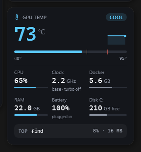

# Heatwatch

Small always-on-top desktop widgets for Windows that keep an eye on a laptop that runs hot. One tray app, four widgets, and a layout that survives restarts.



Built after a laptop kept powering off with no blue screen and no error code. The cause was overheating whenever Docker started a batch of containers. Heatwatch shows the warning signs before that happens, and records what the machine was doing just before a crash.

## Widgets

| Widget | Shows |
|---|---|
| **Thermal** | GPU temperature with a COOL / WARM / HOT badge, a 2-minute graph and a 40–95 °C bar; CPU load, CPU clock (flags Turbo Boost), Docker VM memory, RAM, battery, free space on C:, and the busiest process |
| **Network** | Download and upload speed with a 2-minute graph, Wi-Fi band, adapter, data used today, latency to your router |
| **Containers** | Running Docker containers with CPU and memory, a stop button for each, **Stop all** and **Quit Docker** (both ask first). Shows a **Start Docker** button when Docker is off |
| **System health** | Uptime, last start time, and unexpected shutdowns from the last 30 days. Each one shows the last readings Heatwatch saved before it |

At 85 °C or above, the thermal card turns red and pulses, and the tray icon turns red. At 75 °C it turns amber.

## Requirements

- Windows 10 or 11 with Windows PowerShell 5.1 (built in)
- An NVIDIA GPU for the temperature reading (`nvidia-smi` ships with the driver). Everything else works without one
- Docker Desktop (WSL 2 backend) for the Containers widget (optional)

No install of anything else, no admin rights, and no background service. It's a single PowerShell script using WPF.

## Install

```powershell
git clone https://github.com/ptalati/heatwatch.git
cd heatwatch
powershell -ExecutionPolicy Bypass -File install.ps1 -StartAtSignIn
```

This adds Start menu and desktop shortcuts and starts Heatwatch. Leave out `-StartAtSignIn` if you don't want it to start automatically; you can switch that on later from the tray menu.

To run it once without installing:

```powershell
powershell -NoProfile -STA -WindowStyle Hidden -ExecutionPolicy Bypass -File Heatwatch.ps1
```

## Using it

- **Right-click the thermometer in the tray** to show or hide each widget, lock positions, turn start at sign-in on or off, reset positions, or exit.
- **Hover over the tray icon** to see GPU, CPU and Docker at a glance. Its colour follows the GPU state.
- **Drag a widget** to move it. **Right-click a widget** to hide it or lock positions.
- Only one copy runs at a time.

## What it saves

Everything is in `%APPDATA%\Heatwatch`:

- `settings.json`: which widgets are shown, where each one sits, the lock setting, and today's network totals. Saved whenever you change something and restored on start. Any widget whose saved position is off-screen (for example after unplugging a monitor) moves back into view.
- `readings.csv`: GPU temperature, CPU load, Docker memory and RAM every 10 seconds, trimmed automatically. The System health widget uses it to show what the machine was doing just before an unexpected shutdown.

## Settings in the script

The constants at the top of `Heatwatch.ps1`:

| Constant | Default | Meaning |
|---|---|---|
| `$WarnTemp` / `$HotTemp` | 75 / 85 | GPU °C for the amber and red states |
| `$CpuWarn` / `$CpuHot` | 70 / 90 | CPU load % for amber and red |
| `$DockerCapGB` / `$DockerCpus` | 8 / 4 | Should match `memory` and `processors` in your `%USERPROFILE%\.wslconfig` |

## Limitations

- **No CPU temperature.** Many laptops don't expose it to Windows without a kernel driver. The GPU temperature is a reasonable stand-in on laptops where the CPU and GPU share heat pipes.
- **No per-app network usage.** Windows doesn't provide it cheaply, so the Network widget shows the adapter instead.
- Turbo detection reads Windows' `% Processor Performance` counter. Above 100% means the CPU is boosting past its base clock.

## Uninstall

Choose **Exit** from the tray menu, delete the `Heatwatch.lnk` shortcuts (desktop, Start menu, and `shell:startup`), then delete this folder and `%APPDATA%\Heatwatch`.

## License

MIT
